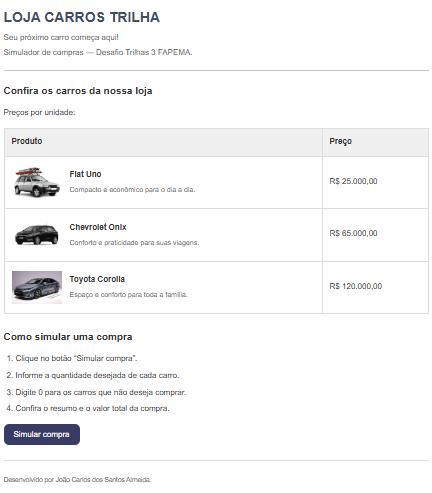

# Loja Carros Trilha — Simulador de Compras

**Aluno:** João Carlos dos Santos Almeida  
**Programa:** Trilhas 3 — FAPEMA  
**Trilha:** [Desenvolvimento Mobile]  
**Desafio:** Minha Loja — Simulador de Compras

## Apresentação

A Loja Carros Trilha é uma loja fictícia de veículos, criada para praticar HTML, CSS e JavaScript. A página apresenta três carros, suas imagens, descrições e preços. O visitante pode simular uma compra informando as quantidades nas janelas do navegador.

Os preços são fictícios e utilizados apenas para fins educacionais. Não há compra real nem processamento de pagamentos.

## Produtos e preços

| Produto | Descrição | Preço por unidade |
| --- | --- | ---: |
| Fiat Uno | Compacto e econômico para o dia a dia. | R$ 25.000,00 |
| Chevrolet Onix | Conforto e praticidade para suas viagens. | R$ 65.000,00 |
| Toyota Corolla | Espaço e conforto para toda a família. | R$ 120.000,00 |

## Tecnologias

- **HTML5:** estrutura da página, tabela de produtos e botão de simulação.
- **CSS3:** cores, espaçamentos, imagens, botão e ajustes para telas menores.
- **JavaScript:** entrada das quantidades, conversão numérica, cálculo e exibição do resumo.

## Organização dos arquivos

```text
loja-carros-trilha/
├── index.html
├── style.css
├── script.js
├── README.md
└── assets/
    ├── fiatuno.webp
    ├── Onix.jpeg
    ├── Corolla.jpg
    └── captura-loja.png
```

`captura-loja.png` deve ser adicionada pelo aluno após tirar a captura da página final.

## Como executar

1. Baixe ou clone o repositório.
2. Mantenha os arquivos na estrutura indicada acima.
3. Abra `index.html` em um navegador com JavaScript habilitado.
4. Clique em **Simular compra**.
5. Informe a quantidade de cada carro. Digite **0** para não comprar um modelo.
6. Confira o resumo apresentado no alerta.


## Funcionamento da simulação

1. Os preços são armazenados em constantes.
2. `prompt()` solicita a quantidade de cada veículo.
3. `Number()` converte as respostas em números.
4. Se todas as quantidades forem zero, um alerta informa que nenhum produto foi selecionado.
5. Caso contrário, o programa calcula o total multiplicando cada preço pela quantidade e somando os resultados.
6. `alert()` apresenta as quantidades, os preços unitários e o total da compra.

**Exemplo:** 1 Fiat Uno + 1 Corolla + 1 Onix = **R$ 210.000,00**.

## Captura de tela





## Testes realizados na revisão

O JavaScript fornecido foi executado em Node.js com `prompt()` e `alert()` simulados. Esses testes verificaram a lógica; não substituem a conferência visual e o teste do botão no navegador.

| Quantidades (Uno / Corolla / Onix) | Resultado observado | Situação |
| --- | --- | --- |
| 1 / 1 / 1 | Total de R$ 210.000,00 | Correto |
| 2 / 0 / 1 | Total de R$ 115.000,00 | Correto |
| 0 / 0 / 0 | Mensagem de nenhum produto selecionado | Correto |
| abc / 0 / 0 | Quantidade e total apresentados como NaN | Validação pendente |
| -1 / 0 / 0 | Total negativo de R$ -25.000,00 | Validação pendente |

Antes da entrega, testar manualmente o carregamento das imagens, o botão, a leitura dos alertas e o layout em telas pequenas. As imagens dos carros não acompanharam os arquivos enviados nesta revisão.

## Dificuldade encontrada e aprendizado

Durante o desenvolvimento, uma dificuldade foi exibir os valores das variáveis no alerta: as expressões `${...}` apareceram como texto. A correção foi utilizar crases para construir os textos e manter os nomes das variáveis iguais aos declarados, respeitando letras maiúsculas e minúsculas.

O exercício ajudou a compreender o uso de `prompt()`, `Number()`, `alert()`, condicionais e operações matemáticas, além da separação entre estrutura HTML, aparência CSS e comportamento JavaScript.

Dificuldades no uso do css na construção do design esperado do desafio

## Uso de inteligência artificial

Foi utilizado apoio de IA para organizar as etapas do desafio, explicar erros de sintaxe, orientar a estilização e elaborar esta documentação. Ao longo do desenvolvimento, foram adaptados o tema da loja, os veículos, os preços e as cores da página.

A revisão conferiu a correspondência entre os preços do HTML e do JavaScript e executou os cenários registrados na tabela de testes. O aluno deve revisar o código, realizar os testes no navegador e ajustar este relato para refletir sua própria compreensão antes da entrega.


## Entrega

Atividade individual entregada dia 24/10/2026